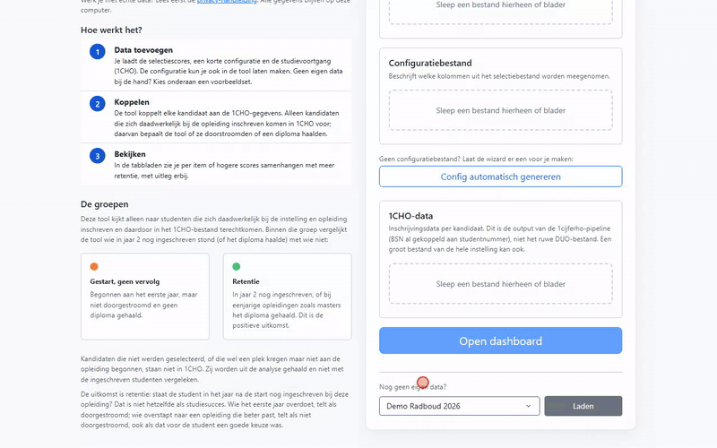

<div align="center">
  <h1>Selectie Evaluatietool</h1>

  <p>Voorspelt je selectieprocedure welke studenten doorgaan?</p>

  <p>
    <a href="#"></a>
    <a href="#"></a>
    <a href="#"></a>
    
    
  </p>
</div>

---

<p align="center">
  
</p>

## Wat doet deze tool?

Een opleiding selecteert studenten, bijvoorbeeld met een toets, een
motivatiebrief of een gesprek. De vraag is: **scoorden de studenten die
doorgingen ook beter bij de selectie?**

Deze tool zoekt dat voor je uit. Je geeft hem drie bestanden:

1. de **selectiescores** van de opleiding (een Excel-bestand);
2. een **config**: een klein Excel-bestand dat zegt welke kolommen scores zijn
   (de tool maakt het voor je);
3. de **inschrijvingsgegevens van DUO** (1cijferho), zodat de tool ziet wie
   na een jaar nog ingeschreven staat.

Je krijgt een dashboard in je browser met grafieken en een samenvatting in
gewone taal, en een PDF-rapport dat je met de opleiding kunt delen.

**Je gegevens blijven op je eigen computer.** De tool draait lokaal; er gaat
niets naar internet. Werk je met echte studentgegevens, neem dan eerst de
[privacy-handleiding](docs/privacy-handleiding.md) door met je privacy officer.

**Voor wie?** Data-analisten en onderzoekers in het onderwijs. Je hoeft niet
te kunnen programmeren. Je moet wel een paar regels kunnen kopiëren en
plakken in een opdrachtvenster; hieronder staat precies welke.

**Inhoud**

- [Stap 1. Installeren en de demo bekijken](#stap-1-installeren-en-de-demo-bekijken) (15 minuten)
- [Stap 2. De DUO-gegevens klaarmaken](#stap-2-de-duo-gegevens-klaarmaken) (één keer per instelling)
- [Stap 3. Het selectiebestand](#stap-3-het-selectiebestand)
- [Stap 4. Je eigen data inladen](#stap-4-je-eigen-data-inladen)
- [Wat zie je in het dashboard?](#wat-zie-je-in-het-dashboard)
- [Hoe lees je de uitkomsten?](#hoe-lees-je-de-uitkomsten)
- [Iets werkt niet](#iets-werkt-niet)


## Stap 1. Installeren en de demo bekijken

Je installeert twee dingen: een hulpprogramma (**uv**) en de tool zelf. uv
haalt automatisch de juiste versie van Python en alle onderdelen op, net zoals
`install.packages()` dat in R doet. Je hoeft Python dus niet zelf te
installeren.

### Windows

**1. Installeer uv.** Open het startmenu, typ `PowerShell` en open het. Er
verschijnt een venster waarin je tekst kunt typen. Kopieer deze regel, plak
hem met rechtermuisklik en druk op Enter:

```powershell
powershell -ExecutionPolicy ByPass -c "irm https://astral.sh/uv/install.ps1 | iex"
```

Sluit het venster als het klaar is.

**2. Download de tool.** Klik op
[deze link om de tool als ZIP te downloaden](https://github.com/cedanl/selectie-evaluatietool/archive/refs/heads/master.zip).
Pak de ZIP uit, bijvoorbeeld in je map Documenten. Je krijgt een map
`selectie-evaluatietool-master`.

**3. Start de tool.** Open die map in de Verkenner. Klik bovenin op de
adresbalk (waar het pad staat), typ `powershell` en druk op Enter. Er opent
een PowerShell-venster dat al in de goede map staat. Plak daarin:

```powershell
uv run python app.py
```

De eerste keer duurt dit een paar minuten, omdat alles wordt opgehaald. Wacht
tot je deze regel ziet:

```
Running on http://127.0.0.1:8050
```

Open dan je browser en ga naar **<http://localhost:8050>**.

Laat het PowerShell-venster openstaan zolang je met de tool werkt. Klaar? Sluit
het venster, of druk erin op Ctrl + C.

**Volgende keer:** alleen stap 3 (map openen, `powershell` in de adresbalk,
`uv run python app.py`).

### macOS

Open **Terminal** (via Spotlight, Cmd + spatie) en plak:

```bash
curl -LsSf https://astral.sh/uv/install.sh | sh
```

Download en unzip de tool via
[deze link](https://github.com/cedanl/selectie-evaluatietool/archive/refs/heads/master.zip).
Open een nieuwe Terminal, typ `cd ` (met een spatie), sleep de map
`selectie-evaluatietool-master` in het venster, druk op Enter en plak:

```bash
uv run python app.py
```

Ga daarna naar **<http://localhost:8050>**.

### Eerst de demo bekijken

Kies onderaan het startscherm bij **Nog geen eigen data?** een voorbeeld en
klik **Laden**. De voorbeelden zijn verzonnen:

- **Demo Geneeskunde 2026**: bachelor Geneeskunde, 500 aanmelders, selectie
  in twee rondes (toetsen, daarna gesprekken). Uitkomst: na een jaar nog
  ingeschreven.
- **Demo Leiden 2026**: eenjarige master Farmacie, 140 kandidaten. Uitkomst:
  diploma gehaald.
- **Demo Radboud 2026**: bachelor Psychologie, 200 kandidaten. Uitkomst: na
  een jaar nog ingeschreven.

Klik alle tabbladen een keer door. Dan weet je wat je met je eigen data
krijgt.


## Stap 2. De DUO-gegevens klaarmaken

Dit doe je **één keer voor de hele instelling**, niet per opleiding.

De levering van DUO (1cijferho) is niet direct leesbaar: het zijn tekstbestanden
met codes in plaats van woorden, en studenten staan erin met hun BSN. De
[1cijferho-tool](https://github.com/cedanl/1cijferho) van CEDA zet dat om naar
een gewone CSV-tabel met leesbare kolommen. Deze tool leest die tabel.

### Wat je nodig hebt

- **De DUO-levering**: de bestanden `EV*.asc`, `Bestandsbeschrijving_*.txt` en
  `Dec_*.asc`. Die moet ook het jaar **na** de start bevatten. Wil je het
  cohort van september 2025 bekijken, dan heb je ook de inschrijvingen van
  2026-2027 nodig.
- **Een koppelbestand**: een lijst die bij elk BSN het nummer geeft waarmee de
  student in het selectiebestand staat. Meestal het studentnummer. Dit
  bestand vraag je op bij de afdeling die de studentadministratie beheert.

Het koppelbestand is een CSV met puntkomma's en precies deze twee kolommen:

```csv
burgerservicenummer;studentnummer
012345678;1234567
234567890;1234568
```

Let op drie dingen:

- **De tweede kolom heet altijd `studentnummer`**, ook als er een
  aanvraagnummer of kandidaatnummer in staat. Dat nummer moet hetzelfde zijn
  als in het selectiebestand.
- **Open het bestand niet in Excel.** Excel haalt de nul aan het begin van een
  BSN weg, en dan klopt de koppeling niet meer. Maak de export direct als CSV,
  bijvoorbeeld met een SQL-query of in R.
- **Elk BSN maar één keer.** Dubbele BSN's laten 1cijferho stoppen.

### Omzetten met 1cijferho

1cijferho installeer en start je op dezelfde manier als deze tool. Download
[de ZIP van 1cijferho](https://github.com/cedanl/1cijferho/archive/refs/heads/main.zip),
pak hem uit, open de map, typ `powershell` in de adresbalk en plak:

```powershell
uv sync --extra frontend
uv run streamlit run src/main.py
```

Er opent een pagina in je browser. Zet eerst de bestanden klaar in de map van
1cijferho:

- de DUO-bestanden **direct** in de map `data\01-input` (niet in een submap);
- het koppelbestand in de map `data`, bijvoorbeeld als `data\koppeling.csv`.

Doe dan in de browser:

1. Klik **Eigen data uploaden**, dan **Bestanden controleren**, en ga door naar
   stap 1.
2. Klik **Extraheren starten** en daarna **Validatie starten**.
3. In stap 3 (Turbo Conversie): kies bij **Instelmodus** de optie
   **Evaluatietool Selectie**, vul bij **Pad naar koppelbestand**
   `data/koppeling.csv` in en klik **Start Turbo Convert**.

### Het resultaat

In de map `data\02-output` staat nu een bestand dat eindigt op
**`_enriched.csv`** (de naam begint met `EV`). Dat bestand heb je straks
nodig. Gebruik niet het bestand zonder `_enriched`: daarin ontbreken
de vooropleiding en de naam van de opleiding.

Controleer dat er een kolom `studentnummer` in staat met de nummers uit je
koppelbestand. Staat die er niet in, dan is het koppelen mislukt.

Eén bestand voor de hele instelling is prima. Bij het inladen kies je welke
opleiding je wilt bekijken.


## Stap 3. Het selectiebestand

Dit is het Excel-bestand van de opleiding met de selectiescores. Het hoeft
geen vast formaat te hebben, zolang het hieraan voldoet:

- **Alle kandidaten staan erin**, ook wie is afgewezen of niet begon.
- **Eén rij per kandidaat.**
- **Een kolom met het nummer uit het koppelbestand** (meestal het
  studentnummer), op precies dezelfde manier geschreven: geen letter ervoor,
  dezelfde nullen aan het begin.
- **De scores zijn getallen.** Elke kolom mag een eigen schaal hebben, zoals
  1-5, 1-10 of 0-100.

Extra tabbladen, een titel boven de tabel of opmaak zijn geen probleem. Haal
namen, e-mailadressen en opmerkingen er bij voorkeur uit.

**Telt een kolom andere kolommen op?** Een subtotaal of totaalscore naast de
losse onderdelen telt dezelfde informatie twee keer. Neem dan óf het
subtotaal óf de onderdelen mee. Dat kies je in de volgende stap.

Voorbeelden van alle bestanden staan in de
[beschrijving van de bestanden](docs/bestanden.md).


## Stap 4. Je eigen data inladen

### De config laten maken

De config vertelt de tool welke kolommen in het selectiebestand scores zijn.
De tool stelt hem voor je op; jij controleert hem.

1. Sleep op het startscherm het selectiebestand in het eerste vak.
2. Klik **Config automatisch genereren**.
3. Controleer bovenin het tabblad, de rij met kolomnamen, de opleiding, het
   **jaar waarin het cohort begon** en de kolom met het studentnummer.
4. Controleer de tabel met kolommen. **Een vinkje betekent: dit is een
   score.** De tool vinkt zelf de scorekolommen aan en laat nummers, tekst,
   datums en totalen uit. Geef elke aangevinkte kolom een korte, duidelijke
   naam; die zie je terug in de grafieken.
5. Klik **Bevestig config** en daarna **Download als Excel**. Bewaar dat
   bestand bij het selectiebestand. Volgend jaar kun je het opnieuw gebruiken.

Krijg je een melding over dubbele informatie of totalen? Dat is geen fout,
maar een punt om zelf even naar te kijken.

### Inladen

1. Zet de drie bestanden in de drie vakken: het selectiebestand bij
   **Selectiedata**, de config bij **Configuratiebestand** en het
   `_enriched.csv`-bestand uit stap 2 bij **1CHO-data**.
2. De tool controleert de bestanden. Groen is goed, geel is een waarschuwing,
   rood moet je eerst oplossen (zie [Iets werkt niet](#iets-werkt-niet)).
3. Staan er meerdere opleidingen in het DUO-bestand, kies dan de goede.
4. Je ziet bijvoorbeeld *70 van 200 kandidaten gekoppeld*. Dat is normaal: de
   anderen zijn afgewezen of niet begonnen.
5. Klik **Open dashboard**.

Klaar? Klik **Nieuw bestand laden**. Dan wordt het DUO-bestand meteen van je
computer verwijderd (anders gebeurt dat na 24 uur).


## Wat zie je in het dashboard?

| Tabblad | Wat je ziet |
|---|---|
| **Introductie** | Wat de tool doet en hoe je de tabbladen leest |
| **Wat valt op** | De belangrijkste bevindingen in gewone taal, met suggesties voor vervolgstappen. Begin hier. |
| **Selectiescores** | Per onderdeel de scores van wie wel en niet doorging, ook naar geslacht of vooropleiding |
| **Demografie** | Per groep (geslacht, vooropleiding) hoeveel studenten doorgingen |
| **Verschiltoets** | Per onderdeel: is het verschil tussen wel en niet doorgegaan groter dan toeval? |
| **Correlatie** | Welke onderdelen grotendeels hetzelfde meten |
| **Regressie** | Welke onderdelen samen het best voorspellen wie doorgaat |

Met **Download rapport (PDF)** zet je alles in één document. Dat duurt
ongeveer een halve minuut.


## Hoe lees je de uitkomsten?

**Wat betekent "doorgegaan"?** Dat de student een jaar na de start nog bij
deze opleiding ingeschreven staat. Wie het eerste jaar overdoet, telt als
doorgegaan; wie overstapt naar een andere opleiding, niet. Bij een eenjarige
master kijkt de tool of de student in het eerste jaar het diploma haalde.

De tool deelt elke kandidaat in een van deze groepen in:

| Groep | Betekenis |
|---|---|
| **Niet gestart** | Afgewezen, of toegelaten maar niet begonnen. Telt niet mee in de vergelijking. |
| **Gestart, niet naar jaar 2** | Begonnen, maar een jaar later niet meer ingeschreven |
| **Doorgestroomd naar jaar 2** | Een jaar later nog ingeschreven |
| **Gestart, diploma gehaald** | Eenjarige master: diploma gehaald in het eerste jaar |

**Waar je op moet letten**

- **Kleine groepen.** Met 50 tot 150 studenten zie je alleen duidelijke
  verschillen. Kleine verschillen kan de tool missen.
- **"Niet significant" betekent niet "werkt niet".** Alleen toegelaten
  studenten hebben een uitkomst. Die scoorden allemaal redelijk goed, dus
  verschillen lijken kleiner dan ze bij alle kandidaten zijn. Schrap dus geen
  selectieonderdeel omdat het hier niets laat zien.
- **Eén jaar is een momentopname.** Herhaal de analyse met het volgende cohort
  voordat je de procedure aanpast.
- **Geslacht en vooropleiding** komen uit de DUO-gegevens. Die zijn alleen
  bekend voor wie begon, dus de tool kan niet zien of de selectie bepaalde
  groepen vaker afwijst.
- **Privacy.** Groepen kleiner dan vijf studenten toont de tool als `< 5`.

<details>
<summary>Welke statistiek gebruikt de tool?</summary>

- **Verschiltoets:** Mann-Whitney U (doorgegaan of niet) en Kruskal-Wallis
  (geslacht, vooropleiding), met effectgrootte.
- **Meervoudig toetsen:** p-waarden per tabel gecorrigeerd met
  Benjamini-Hochberg. Sterren en conclusies gebruiken de gecorrigeerde p.
- **Regressie:** logistische regressie op z-scores, per item en gezamenlijk.
  Zijn er te weinig studenten per item (minder dan 5 per voorspeller in de
  kleinste groep), dan kiest de tool vooraf de items met de laagste p-waarde.
  De p-waarden van het gezamenlijke model zijn dan te gunstig; de tool meldt
  dat. Items die bijna hetzelfde meten (VIF boven 10) of de groepen volledig
  scheiden, laat de tool eruit en zegt waarom.
- **Correlatie:** Pearson, geduid volgens Cohen (1988).
- **Ontbrekende scores:** items met meer dan 30% ontbrekend gaan niet in de
  regressie; de rest wordt aangevuld met het gemiddelde.

Alle keuzes staan uitgebreid in [CLAUDE.md](CLAUDE.md).
</details>


## Iets werkt niet

| Wat je ziet | Wat er aan de hand is | Wat je doet |
|---|---|---|
| **Geen overlap tussen selectiedata en 1CHO-data** | De nummers in de twee bestanden komen niet overeen | Kijk of het DUO-bestand een kolom `studentnummer` heeft. Zo niet, draai 1cijferho opnieuw met het koppelbestand. Zo wel, vergelijk een paar nummers uit beide bestanden: staat er een letter voor, of ontbreken nullen aan het begin? |
| **Ontbrekende achtergrondkolommen in 1CHO** | Je gebruikte het DUO-bestand zonder `_enriched` | Gebruik het bestand dat eindigt op `_enriched.csv` |
| **Ontbrekende kolommen in 1CHO** | Het bestand komt niet uit 1cijferho, of is in Excel bewerkt | Gebruik het `_enriched.csv` zoals 1cijferho het maakte |
| **Blad / ID-kolom / kolom … niet gevonden** | De config past niet bij het selectiebestand | Laat de config opnieuw maken met **Config automatisch genereren** |
| **… komen bij meer dan één kolom voor** | Twee aangevinkte kolommen hebben dezelfde naam | Geef elke kolom een eigen naam |
| **… staan meerdere keren in de selectiedata** | Een kandidaat staat er twee keer in, met verschillende scores | Laat de opleiding uitzoeken welke rij klopt |
| Bijna iedereen staat bij **Gestart, niet naar jaar 2** | De DUO-levering bevat het jaar na de start nog niet | Gebruik een nieuwere levering |
| **uv wordt niet herkend** | Het venster was al open tijdens de installatie van uv | Sluit PowerShell en open het opnieuw |
| **port 8050 in use** | De tool draait al in een ander venster | Gebruik dat venster, of sluit het eerst |

Kom je er niet uit? Maak een
[issue](https://github.com/cedanl/selectie-evaluatietool/issues) aan met een
schermafdruk van de melding. **Stuur nooit echte studentgegevens mee.**

**Volgend jaar:** download de nieuwste versie van beide tools, zet de nieuwe
DUO-levering om en gebruik de config van vorig jaar opnieuw. Pas daarin alleen
het jaar aan. Zie je twee jaar achter elkaar hetzelfde patroon, dan is dat een
stevigere basis dan één jaar.


## Meer lezen

- [Beschrijving van de bestanden](docs/bestanden.md): alle bestanden in detail,
  met voorbeelden
- [Privacy-handleiding](docs/privacy-handleiding.md): wat de tool met gegevens
  doet, met een checklist voor je privacy officer
- [Documentatie van 1cijferho](https://cedanl.github.io/1cijferho/)

<details>
<summary>Voor wie met de opdrachtregel werkt</summary>

Met Git:

```bash
git clone https://github.com/cedanl/selectie-evaluatietool.git
cd selectie-evaluatietool
uv run python app.py
```

1cijferho zonder browser:

```bash
uv run eencijferho pipeline --input data/01-input --output data/02-output --bsn-mapping-file data/koppeling.csv
```

Ontwikkelen:

```bash
uv sync
uv run python app.py          # localhost:8050 (DASH_DEBUG=1 voor de debugger)
uv run pytest -q
uv run ruff format . && uv run ruff check --fix .
```
</details>

---

<div align="center">
  <sub>Ontwikkeld door <a href="https://github.com/cedanl">CEDA NL</a> · MIT-licentie</sub>
</div>
